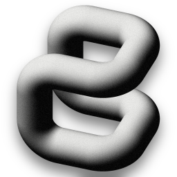

  

<h1 align="center">Curva</h1>

Curva is an open-source, design-oriented 3D suite for architects and designers, written in Rust.
It combines Rhino-style freeform modelling with the "memory" of Archicad and Revit: objects that
remember how they were made, live 2D plans and sections, and sheets.

**Status:** preview, 0.4.1: Milestone 1 complete, with line weights, an AI Assistant, one-click updates, a Rhino-style gumball and every Rhino NURBS command the geometry engine can do. Early and
unpolished; a Windows installer, a Linux AppImage and a macOS disk image are on the Releases page.

## Where things are

| File / folder | What it is |
|---|---|
| `docs/architecture.md` | The plan for the whole project |
| `STATUS.md` | Points to `status/display.md` and `status/features.md`: where each stream of work is, updated after every work session |
| `AGENTS.md` | The rules every AI agent and contributor follows |
| `docs/decisions/` | One short note per important decision: what, why, what was rejected |
| `docs/specs/` | Specs for features, approved by the project owner before work starts |

## Licence

- **The Curva application** (`curva-app`, `curva-commands`, `curva-viewport`, `curva-mcp`):
  GPL-3.0-or-later (`LICENSE`), with a plugin exception (`PLUGIN-EXCEPTION.md`): plugins that use
  the official Plugin API may use any licence, including closed ones.
- **The libraries** (`curva-kernel`, `curva-document`, `curva-3dm`, `curva-dxf`, `curva-pdf`):
  MIT OR Apache-2.0, at your option (`LICENSE-MIT`, `LICENSE-APACHE`).

Why: `docs/decisions/0025-gpl-for-the-application.md`.
Third-party work Curva builds on is credited in `ATTRIBUTION.md`.
