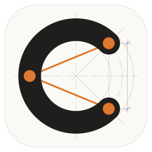

  

<h1 align="center">Curva</h1>

Curva is an open-source, design-oriented 3D suite for architects and designers, written in Rust.
It combines Rhino-style freeform modelling with the "memory" of Archicad and Revit: objects that
remember how they were made, live 2D plans and sections, and sheets.

**Status:** preview, 0.3.0: Milestone 1 complete, with a new look, arrangeable panels, a Rhino-style gumball and Rhino-style commands. Early and
unpolished; a Windows installer, a Linux AppImage and a macOS disk image are on the Releases page.

## Where things are

| File / folder | What it is |
|---|---|
| `docs/architecture.md` | The plan for the whole project |
| `STATUS.md` | Where the project is right now, updated after every work session |
| `AGENTS.md` | The rules every AI agent and contributor follows |
| `docs/decisions/` | One short note per important decision: what, why, what was rejected |
| `docs/specs/` | Specs for features, approved by the project owner before work starts |

## Licence

Code: MIT OR Apache-2.0, at your option. See `LICENSE-MIT` and `LICENSE-APACHE`.
Third-party work Curva builds on is credited in `ATTRIBUTION.md`.
