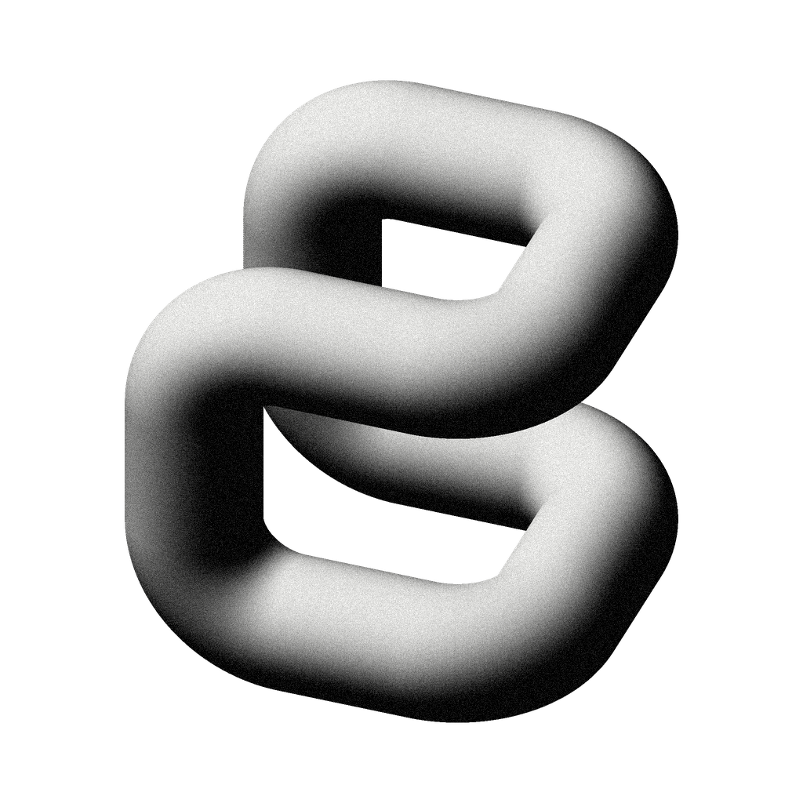

  <picture>
    <source media="(prefers-color-scheme: dark)" srcset="docs/design/brand/logo-3d/renders/set/white-mark.png">
    
  </picture>

<h1 align="center">Curva</h1>

<strong>Every project starts with a curve.</strong>

<a href="https://curva3d.com">curva3d.com</a> · <a href="https://curva3d.com/docs/">Documentation</a> · <a href="https://github.com/curva3d/curva/releases">Download</a>

Curva is an open-source 3D suite for architects and designers, written in Rust. It models freely,
like Rhino; its objects remember how they were made; and its plans, sections and sheets come live
from the model, like Archicad and Revit. One program, with specializations that change the tools
for the kind of work, all on one model.

| Specialization | Status | What it does |
|---|---|---|
| [**Freeform**](https://curva3d.com/freeform/) | Out now | Rhino-level modelling: curves, surfaces, solids, meshes and SubD, with Rhino's commands, a model with memory, and sheets |
| [**Architecture**](https://curva3d.com/architecture/) | Coming next | Smart building elements that draw themselves in 3D, plan and section; live plans, sections and elevations; IFC |
| [**Urban**](https://curva3d.com/urban/) | Planned | Massing from rules, real context, streets and blocks generated from street sections, live area and density data |
| [**Analysis**](https://curva3d.com/analysis/) | Later | Sun and shadow, wind, views and carbon, run on the live model |
| [**Publisher**](https://curva3d.com/publisher/) | Planned | From the model to the drawing set: sheets and drawing sets, title blocks, revisions, presentation boards and exports, all live from the model |

**Status:** preview, 0.1.5. Freeform with NURBS, meshes and SubD; layouts, Make2D, dimensions and
printing; Rhino `.3dm`, DWG, DXF, SketchUp, STEP and mesh files; commands checked against Rhino 8.
Early and unpolished: a Windows installer, a macOS disk image and a Linux AppImage are on the
[Releases page](https://github.com/curva3d/curva/releases).

## Where things are

| File / folder | What it is |
|---|---|
| `docs/architecture.md` | The plan for the whole project |
| `STATUS.md` | Points to `status/display.md` and `status/features.md`: where each stream of work is, updated after every work session |
| `AGENTS.md` | The rules every AI agent and contributor follows |
| `docs/decisions/` | One short note per important decision: what, why, what was rejected |
| `docs/specs/` | Specs for features, approved by the project owner before work starts |

## Licence

- **The Curva application** (`curva-app`, `curva-commands`, `curva-viewport`, `curva-mcp`):
  GPL-3.0-or-later (`LICENSE`), with a plugin exception (`PLUGIN-EXCEPTION.md`): plugins that use
  the official Plugin API may use any licence, including closed ones.
- **The libraries** (`curva-kernel`, `curva-mesh`, `curva-meshfiles`, `curva-document`, `curva-3dm`, `curva-dxf`, `curva-pdf`):
  MIT OR Apache-2.0, at your option (`LICENSE-MIT`, `LICENSE-APACHE`).

Why: `docs/decisions/0025-gpl-for-the-application.md`.
Third-party work Curva builds on is credited in `ATTRIBUTION.md`.
